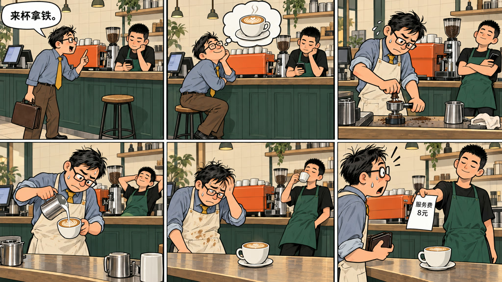

<h1></h1>

### 凭直觉，把想法变成画面。

写下想法，放入参考图；哪里不满意，就点哪里，告诉它你想怎么改。

[GitHub 下载](https://github.com/DocWorkBox/DoxFrame/releases/latest) · [夸克网盘下载](https://pan.quark.cn/s/720abc384786) · [访问官网](https://doxframe.docworkbox.com/) · [观看短片样例](https://doxframe.docworkbox.com/#film)

---

## 从一个想法开始

DoxFrame 是一款面向图片与视频创作的桌面工具。连接 AI 生成服务后，你可以用自己的话描述想做的内容，从一张画开始，也可以把一个想法发展成绘本、短片或条漫。

<table>
  <tr>
    <td width="50%"> <b>短片 · 借你一点光</b> 画面、动态镜头、旁白和配乐组成的 18 秒故事。</td>
    <td width="50%"> <b>静帧绘本 · 雨夜里的小小相遇</b> 让逐页画面、文字与旁白一起讲故事。</td>
  </tr>
  <tr>
    <td width="50%"> <b>一张画 · 借影成龙</b> 用一句描述，生成一幅画面。</td>
    <td width="50%"> <b>条漫 · 自助</b> 将分格画面和文案组合成长条漫画。</td>
  </tr>
</table>

[▶ 在官网观看《借你一点光》完整短片](https://doxframe.docworkbox.com/#film)

## 点哪里，改哪里

先看到一版作品，再选择想修改的地方。点选物体后，画面会显示高亮选区；用日常语言描述想要的变化，查看修改候选和前后对比，满意后再采用。

*视频局部编辑示例：点选挎包，确认选区后再跟踪并修改。*

*同一段画面的本地改色对比。* [▶ 在官网观看动态对比](https://doxframe.docworkbox.com/#explore)

## 你可以这样创作

1. **写下想法**：选择一张画、静帧绘本、短片或条漫，输入描述，也可以添加参考图。
2. **生成与调整**：选择画风；绘本、短片和条漫可以先编写并修改文案或分镜，再继续生成画面。
3. **查看并修改**：点选画面中的物体，查看选区和修改候选；也可以调整整张画面的风格。
4. **添加声音并导出**：为作品添加旁白或配乐，预览后导出图片、视频或可编辑备份。

作品、素材和历史版本可在软件中管理。部分本地处理功能无需调用生成服务；AI 生成和部分编辑功能需要连接相应服务并配置 API Key，具体可用功能取决于所连接的服务。

## 下载

前往 [GitHub Releases](https://github.com/DocWorkBox/DoxFrame/releases/latest) 查看版本说明及校验值，并下载适合自己系统的安装包：

- **macOS**：Apple 芯片版 `.dmg`
- **Windows**：x64 版安装程序 `.exe`

其他入口：[夸克网盘下载](https://pan.quark.cn/s/720abc384786) · [DoxFrame 官网](https://doxframe.docworkbox.com/)

---

DoxFrame · by <a href="https://docworkbox.com/">Doc_workBox</a>

